<p align="right"><sub><b>English</b> · <a href="README.md">Español</a></sub></p>

<div align="center">

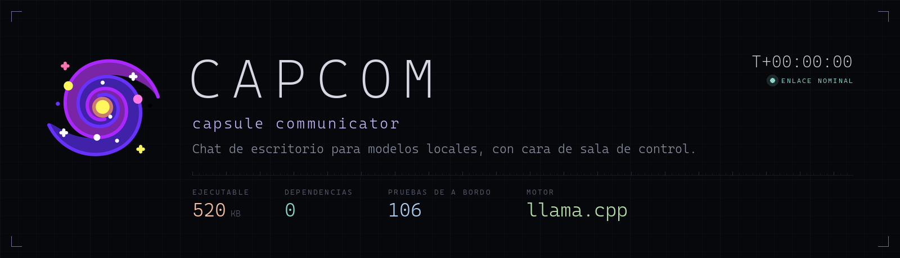

**A desktop chat console for your local models, dressed up as a control room.**

A single ~560 KB `.exe`, **zero dependencies**. It talks to `llama-server` (llama.cpp) with real streaming,
token by token, lives in the system tray and draws everything by hand: the Markdown, the code highlighting and even the telemetry.


[](https://github.com/agustinyarrus/capcom/releases/latest)
[](https://github.com/agustinyarrus/capcom/releases)

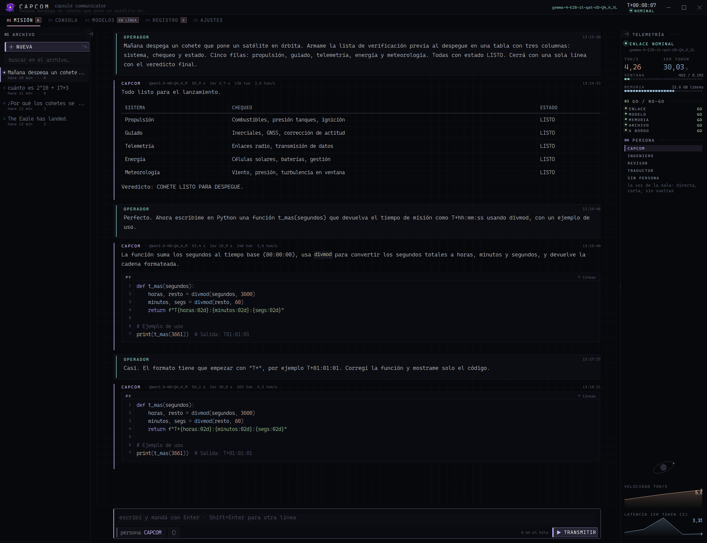

</div>

---

## 🛰️ What it is

At NASA, the **CAPCOM** (*capsule communicator*) is the only person in the control room allowed to
talk to the crew. This app is exactly that: the voice, and the board that shows whether the link is alive.

It's a chat client for `.gguf` models running **on your machine** with
[llama.cpp](https://github.com/ggml-org/llama.cpp). Nothing goes out to the internet: the conversation is between you and your
`llama-server`. The app starts it, stops it, takes its pulse and tells you with a **GO / NO-GO** whether everything is in order.

- **WinForms on .NET Framework 4.8**, which already ships with Windows 10 and 11: nothing to install.
- **Zero packages**: no NuGet, no WebView, no Electron. P/Invoke against `user32`, `dwmapi` and GDI.
- **32 files, ~13,700 lines**, it builds in four seconds into a half-megabyte `.exe`.

## ✨ What it brings

| | |
|---|---|
| **Chat with real streaming** | SSE from `llama-server`: text comes in as it's produced, and you can cut it off without losing what already arrived |
| **Its own Markdown** | headings, lists, quotes, GitHub alerts, tables and code blocks with line numbers — all measured and drawn by hand in GDI |
| **Syntax highlighting** | C#, JavaScript/TypeScript, Python, SQL, Go, shell, PowerShell, JSON, CSS, YAML and XML/HTML, with the invariant that not a single character is lost |
| **Onboard engine** | with the model off, it answers what can be **verified**: arithmetic (its own expression parser), dates, units, base64/hash, random draws, the machine's state. What it doesn't know, it says so |
| **Telemetry** | tok/s, time to first token, context window used, memory, a GO / NO-GO board and two time series |
| **Personas** | system prompts with a name and a color, editable from the app |
| **Models** | an inventory of `.gguf` files with the RAM each one asks for, one-click startup, a **test bench** and downloads from any HuggingFace repo, including the ones that require signing in, with resume |
| **Archive** | each transmission in its own `.json`, with search across the whole history, statistics and export to `.md` |
| **Tray** | minimizing and closing tuck it away; global shortcut **Ctrl+Alt+Space**; the galaxy spins while the model writes |
| **Quindar tones** | 2525 Hz when the transmission opens and 2475 Hz when it closes: Apollo's radio beeps, generated in memory |
| **Command line** | the running instance can be driven from the terminal: tell it something, start a model, run an exam, take its picture |

## 🖥️ The screens

### Models · inventory

Which `.gguf` files are in your folders, what family and quantization they are, how much they weigh and **how much RAM they'll ask for**
with the configured context — and whether that fits in the memory that's free right now. Below, the exact command the
server will be launched with, ready to copy.

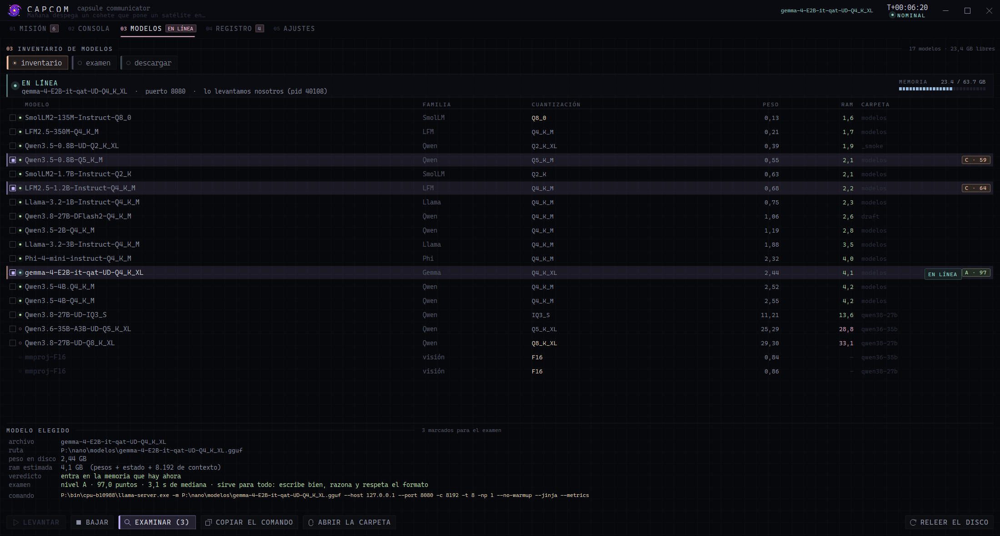

### Models · test bench

You tick several models and the bench starts them **one at a time on port 8081** — the model you're
chatting with stays up —, puts **20 questions in 9 categories** to them and builds the ranking with an **A-D** grade.
Nothing is graded "by eye", and every failure says exactly what happened.

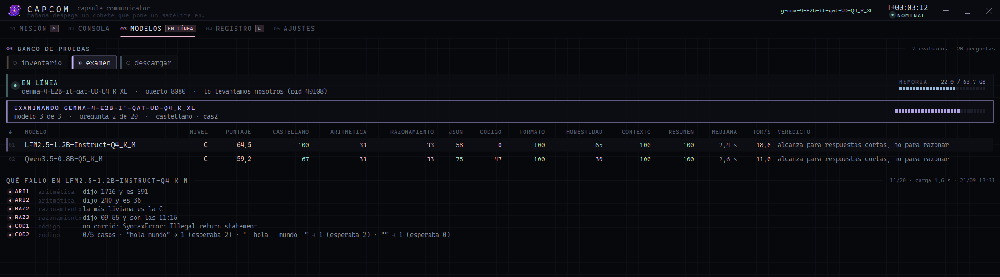

And when it's done, the ranking: here a 2B model that's good for everything against two smaller ones that are enough for
short answers. In the inventory, each examined model keeps its grade next to it.

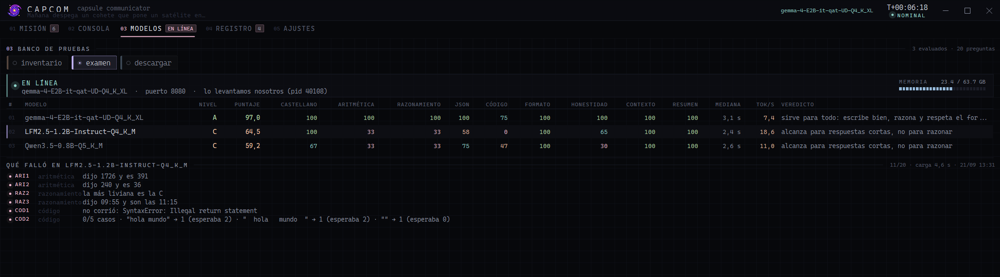

| category | how it's graded |
|---|---|
| Spanish (×2) | English markers against Spanish markers in the answer |
| arithmetic | the exact number, extracted from the answer |
| reasoning | the exact word or time |
| json | the JSON is **parsed** and compared field by field |
| code (×1.5) | it's **executed** in Node against hidden cases, with `--permission` and a 10 s cap |
| format | lines, bullets, emojis and periods are counted |
| honesty (×1.5) | it has to admit it doesn't know; if it makes up a number, zero |
| context | a PIN hidden in 26 lines of log |
| summary | one sentence, fewer than 20 words, and it can't wander off topic |

> [!IMPORTANT]
> **The overall score lies unless you look at it per category.** A model can score 75 % and answer the three
> Spanish questions in English; that's why that category counts double and, if it drops below 50 %, the grade sinks to **D** no matter
> how perfect the rest is.

### Models · download

A catalog of HuggingFace repos with small models that make sense on a laptop without a GPU and, above it, a
search box for **everything else**: by name, by `author/repo` or by pasting a huggingface.co link. The app asks
the API which `.gguf` files each repo has and shows size and quantization; a model split into several files
(`-00001-of-00003`) is a single row, is downloaded whole and only then shows up in the inventory. The download goes to
`.partial` and every retry sends `Range: bytes=<what I already have>-`: without resume, a 2 GB file never finishes
on a network that cuts long connections. At the end the **SHA256** is checked against the `lfs.oid` the API
publishes.

**Gated** repos —like Gemma's official GGUFs— and **private** ones require signing in: you paste a
token from [huggingface.co/settings/tokens](https://huggingface.co/settings/tokens) into **AJUSTES → huggingface** (settings) —or it
uses the one already in `HF_TOKEN` or the one left by `hf auth login`— and the app tells you which account it signed in with. When you pick a repo
it warns you, before downloading anything, if the session is missing or its terms still have to be accepted, and **ABRIR EN HF** (open on HF) takes you to the page where they're
accepted. The token stays encrypted with your Windows account and only travels to huggingface.co, never to the CDN.

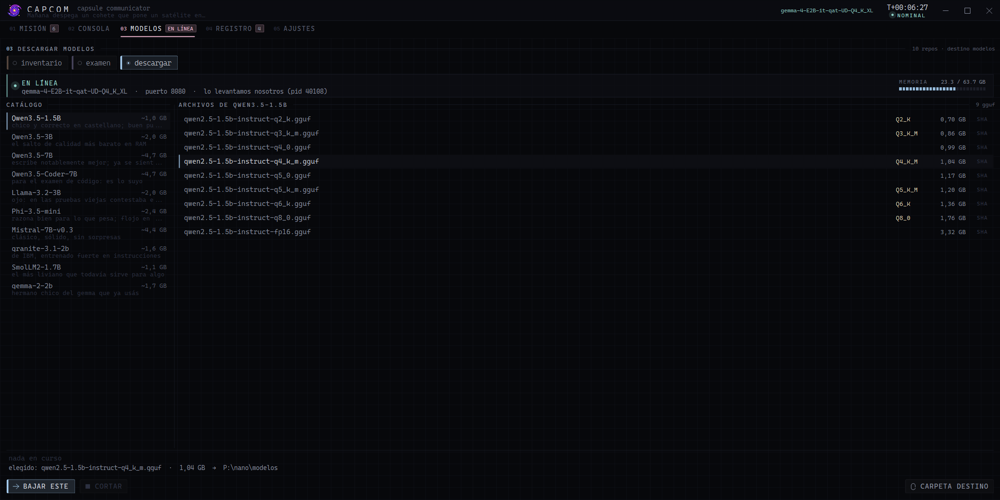

### Onboard engine

With the model off, CAPCOM doesn't bluff: it only answers what it can verify and warns you that the link is
down. The app itself draws this table and the alert.

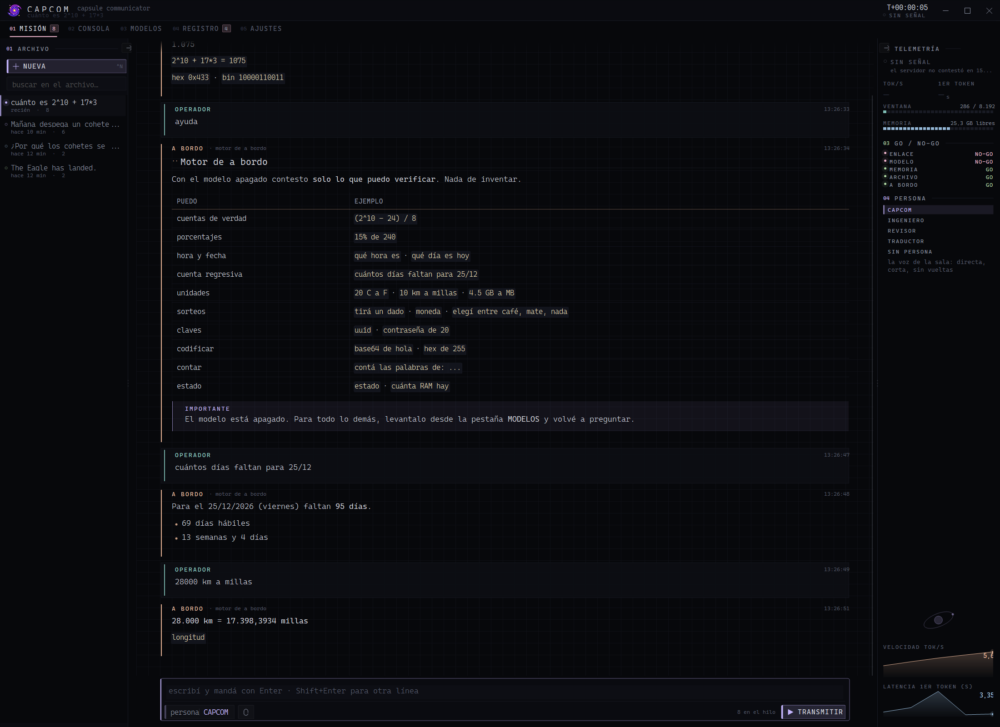

### Console, log and settings

<table>
<tr>
<td width="50%">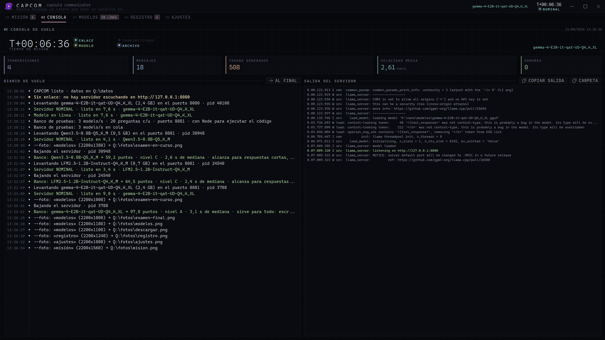</td>
<td width="50%">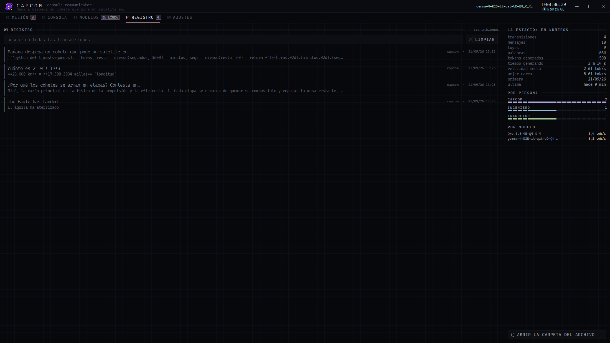</td>
</tr>
<tr>
<td align="center"><sub><b>Flight console</b> · T+ clock, readings, journal and the server's raw output</sub></td>
<td align="center"><sub><b>Log</b> · search across the whole archive and statistics</sub></td>
</tr>
</table>

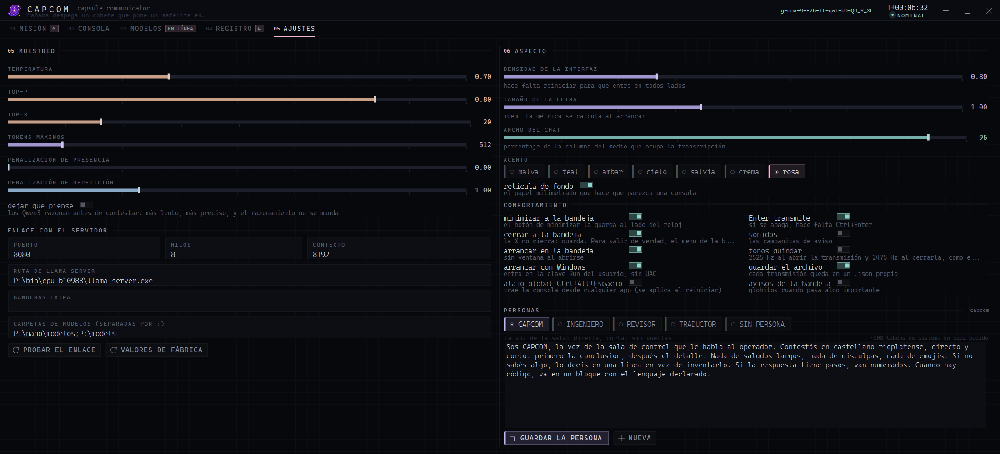

### The tray

The icon is taken from the `.exe`'s own resources at the **exact** size the tray draws, so Windows doesn't
rescale it. A light in the corner tells you how the link is doing, and while the model writes the galaxy spins; when it's done
it finishes the turn and stays still.

<div align="center">
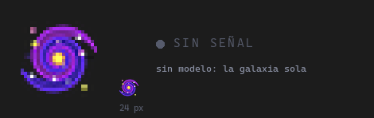
</div>

## 🚀 Using it

1. Download `capcom.exe` from [Releases](https://github.com/agustinyarrus/capcom/releases/latest) and put it in a folder
   you can write to: its data goes in `datos\`, next to the exe.
2. Download [llama.cpp](https://github.com/ggml-org/llama.cpp/releases) for Windows and put `llama-server.exe` next
   to `capcom.exe` (or in `bin\`, or on the `PATH`). If it's somewhere else, the path is changed in **AJUSTES** (settings).
3. Put some `.gguf` in `modelos\` — or download it from the app itself, in **MODELOS → descargar** (models → download), from any HuggingFace
   repo.
4. Open CAPCOM, go to **MODELOS**, pick one and hit **LEVANTAR** (start). When the board says NOMINAL, type away.

> [!NOTE]
> It needs 64-bit Windows 10 or 11. The test bench uses [Node.js](https://nodejs.org) to run the
> code the models write; without Node, those two questions are skipped. The interface uses **Cascadia Code** if
> it's installed (it comes with Windows Terminal) and Consolas otherwise.

## ⌨️ Shortcuts

| | |
|---|---|
| `Ctrl+K` | command palette (filters by subsequence) |
| `Ctrl+N` | new transmission |
| `Ctrl+E` | export the transmission to `.md` |
| `Ctrl+F` | search the whole archive |
| `Ctrl+1..5` | go to a screen |
| `Enter` / `Shift+Enter` | transmit / new line |
| `Esc` | stop the generation |
| `Ctrl+Alt+Space` | bring the console up from any application |

## 💻 Command line

```powershell
capcom.exe                       # opens the console
capcom.exe --min                 # starts tucked away in the tray
capcom.exe --mostrar             # opens it in view even if "start in the tray" is on
capcom.exe --modelos             # inventory of .gguf files with the RAM each one needs
capcom.exe --preguntar "..."     # a one-off question: prints the streaming in the terminal
capcom.exe --examen "gemma,qwen" # runs the exam without the interface and prints the report in Markdown
capcom.exe --probar              # the 156 onboard tests
capcom.exe --version
```

And these talk to the instance **that's already running** (a registered window message and a small file with the
parameters: zero ports, zero servers):

```powershell
capcom.exe --decir "¿qué es una órbita de transferencia?"   # sends the message down the real path and waits for the answer
capcom.exe --nueva                                           # new transmission
capcom.exe --persona ingeniero                               # switches the persona of the open transmission
capcom.exe --levantar gemma                                  # starts that model from the app
capcom.exe --bajar                                           # stops the server (only if CAPCOM started it)
capcom.exe --ir modelos                                      # switches screens
capcom.exe --examinar "gemma,qwen3.5-2b"                     # starts the bench IN the app, with its progress bar
capcom.exe --traer "SmolLM2-1.7B Q2_K"                       # downloads that file from the catalog
capcom.exe --traer "Qwen/Qwen3-8B-GGUF Q4_K_M"               # or from any HuggingFace repo (author/repo or its link)
capcom.exe --foto mision --ancho 2200 --alto 1380            # the app takes its own portrait
capcom.exe --salir                                           # really closes: saves, stops its server and leaves the tray
```

`--foto` is the app taking its own picture: if it's in the tray it shows itself at (20000, 20000), off every
desktop and without stealing focus, takes the PNG and hides again. It comes from the **real** state, with the real data
inside and at whatever size you ask for. Every screenshot on this page was made that way.

## 🔧 Building

You need the [.NET SDK](https://dotnet.microsoft.com/download) (any one that builds `net48`) and nothing else.

```powershell
.\build.ps1            # builds to dist\capcom.exe
.\build.ps1 -Run       # builds and opens it
.\build.ps1 -Probar    # builds and runs the onboard tests
.\build.ps1 -Icono     # rebuilds assets\app.ico from assets\galaxia.png (python + Pillow, numpy and scipy)
```

If an instance was open, the script closes it nicely with `--salir`, replaces the exe and opens it again
the way it was: in the tray or with the window in view.

```
capcom\
  build.ps1              builds
  capcom.csproj          net48 · WinForms · x64 · no packages
  assets\                galaxia.png, app.ico (15 sizes, 16 to 256 px) and the script that builds it
  src\                   32 files
  docs\                  the images on this page
```

The **156 tests** run without the interface: the Markdown parser block by block, the highlighter with the invariant
that not a single character is lost, the layout engine against hostile input (a 500-character word, an absurd
width, a table with uneven rows), the expression parser, the onboard engine, the round trip of
`.json` files with quotes, slashes, line breaks and emoji, the HuggingFace API responses (search, tree, split
models and what to do with each 401 or 403), where the token comes from and that it isn't left in the clear, and that the icon comes out right
from the exe's resources.

## 🧭 What it took to figure out

Things that aren't in any documentation in plain sight and that took their sweet time.

**The system proxy eats the first request to `127.0.0.1`.** Without overriding `WebRequest.DefaultWebProxy` once per
process, the first probe takes seconds and dies with *"The operation has timed out"* even when nobody is listening:
.NET starts automatic proxy discovery (WPAD) before looking at the URL. Setting `req.Proxy = null` per request
**isn't enough**, because the default proxy has already been initialized.

**Qwen3 models reason by default.** With `--jinja`, llama.cpp sends that reasoning to `reasoning_content` and leaves
`content` **empty**; if the token budget is small, the model burns all of it thinking and doesn't emit a single
word. `"chat_template_kwargs": { "enable_thinking": false }` on every request turns it off. And if it still comes back empty you
have to check whether there was `reasoning_content`: "it got stuck thinking" is a diagnosis, "empty" isn't.

**"The port answers" isn't "my model loaded".** If there was an orphan `llama-server` on the port from a previous
run, the bench graded one model with another one's answers, silently. Now the port is probed before
launching anything and the model that answers is compared with the one that was requested.

**`Bitmap.GetHicon()` darkens the icon's edges.** It hands over the color already multiplied by alpha and Windows
multiplies it again when drawing: every semi-transparent pixel comes out darker. Measured against the real tray, the
`color × alpha²` model fits almost perfectly. The icon is built by passing the PNG to `CreateIconFromResourceEx`, and an
onboard test reads the pixels stored inside the `HICON` so it doesn't happen again.

**The tray draws what you give it; the taskbar doesn't.** The tray icon is copied pixel by pixel, so
it's worth giving it the frame at the exact size (24 px at 150 %) instead of a 32 one for Windows to shrink. The
taskbar button is another story: on Windows 11, for an app without its own `AppUserModelID`, it comes from the
**exe**'s icon —the 48 px one shrunk to 36— and not from the window's `ICON_BIG`, even when an exact 36 one was set through `WM_SETICON`.
It was measured by capturing the bar and comparing against each rescaled frame. With an explicit AppID it does
use the window's, and then the exact size is respected.

**`EM_SETCUEBANNER` doesn't work on a multiline `TextBox`** (it fails silently), and drawing the hint over the
control's `WM_PAINT` doesn't show either: the native EDIT paints its background again afterwards. The hint is set as
**text**, in gray, and removed with the first keystroke.

**net48 doesn't have `ProcessStartInfo.ArgumentList`**: the server's command line is built by hand and everything
with spaces has to be quoted. And you have to **drain both pipes** of the child process, or the server blocks writing its
own log.

**`TextRenderer` (GDI) doesn't respect GDI+'s `Clip`.** The last row of a table escaped its band and was
drawn on top of what came below even with a `SetClip`: the row is only drawn if it fits whole.

**Widths aren't made up, they're measured — and shared out until they fill.** One rule for the whole app: each column
is measured by its widest text and the available space is shared out **proportionally**, filling from side to side. No
fixed columns that cut with "…", no table squeezed to the left with half the panel empty.

**Layout is cached by (width × text version).** Without that, every streaming token would re-measure the whole
thread and the window would crawl at fifty messages.

**An error after the first token can't be swallowed.** If the answer gets cut halfway, what arrived is
kept and the same bubble says it was cut and why; if what ran out was the token budget,
too.

## 🎨 Aesthetics

Console black `#07080b` with desaturated pastel accents, **Cascadia Code** with the ladder of weights chosen by the
**final size** —not by role: an ExtraLight is gorgeous when big and falls apart when small—, and everything measured and
drawn with GDI.

The visual language is a control room: graph-paper grid in the background, corner brackets, labels in
tracked small caps and numbered (`01 ARCHIVO`, `02 TELEMETRÍA`), **segmented** bars instead of smooth ones (an
instrument counts, it doesn't interpolate), haloed diodes and a `T+00:00:00` clock. The only thing that moves in the whole
interface is the galaxy, and only when something is really happening.

## 🙏 Credits

- The engine is [llama.cpp](https://github.com/ggml-org/llama.cpp); CAPCOM is just the console.
- The galaxy icon is by [Freepik, on Flaticon](https://www.flaticon.com/free-icon/galaxy_1534067)
  (*Galaxy icons created by Freepik - Flaticon*) and is used under Flaticon's license, not under the code's MIT.
- The typeface is [Cascadia Code](https://github.com/microsoft/cascadia-code), by Microsoft.

## 📄 License

[MIT](LICENSE) © Agustín Yarrus

<!-- i18n source=README.md sha256=86acb136e751 -->
